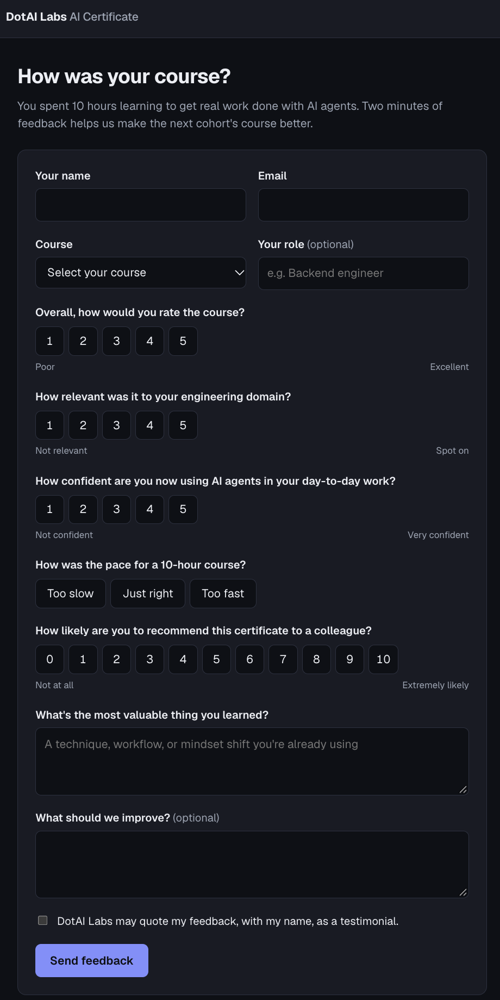
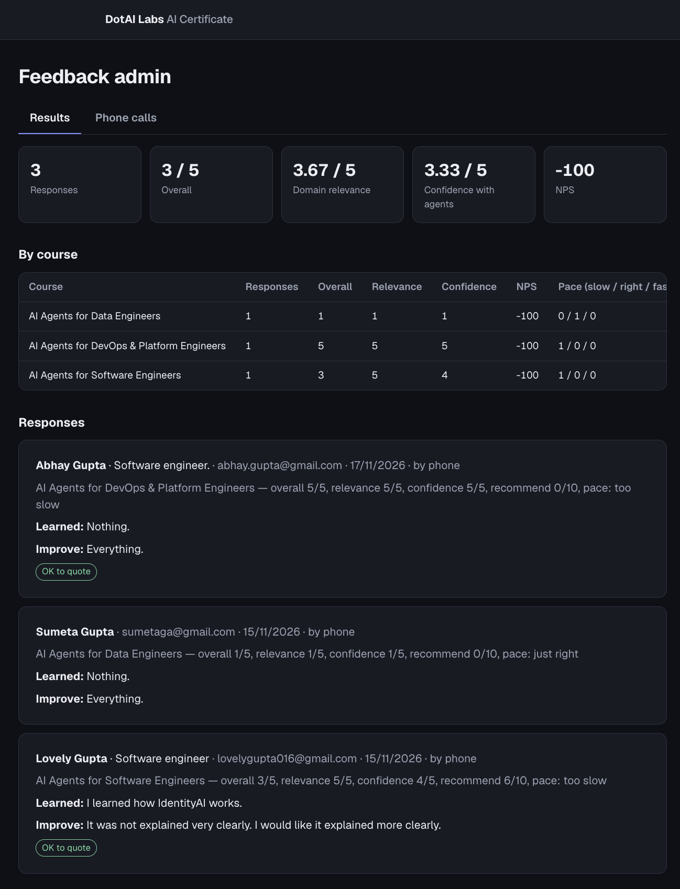
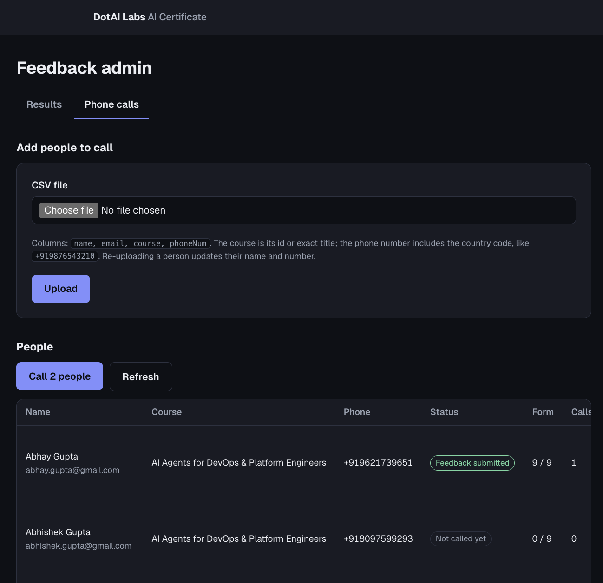
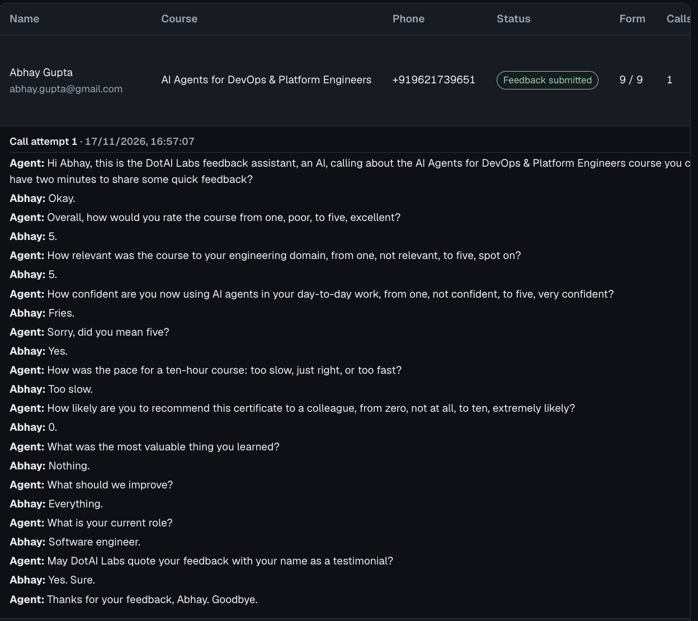
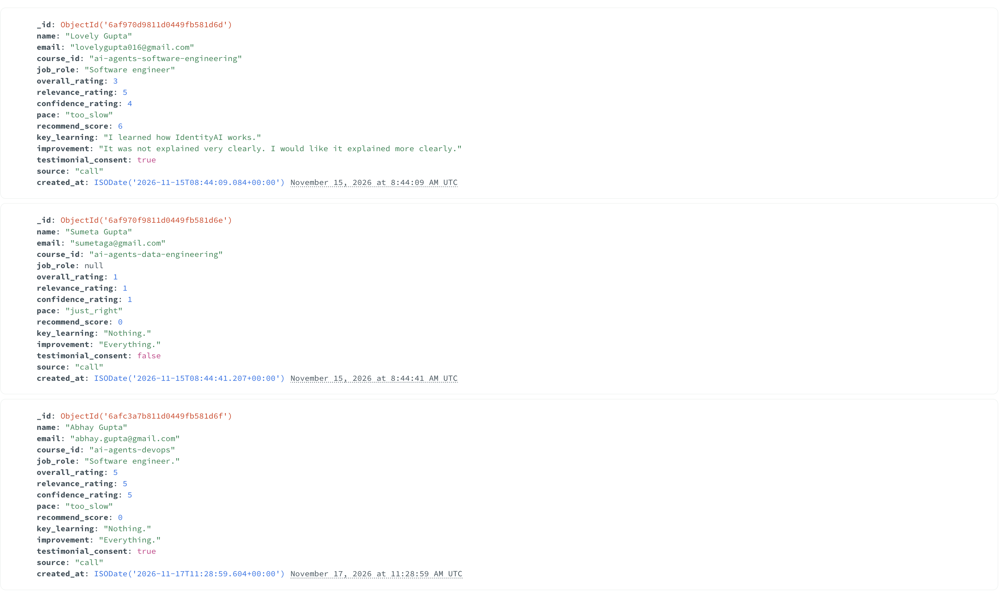

# AI Phone Feedback Agent

Collects course feedback from learners in two ways:

1. **Web form.** Learners fill in a feedback form in the browser.
2. **AI phone calls.** An admin uploads a list of people, and an AI voice agent phones each one
   through **Twilio**. The agent asks the same questions as the form, saves each answer as it
   hears it, and submits the form for the person.

Both paths write to the same `feedbacks` collection in MongoDB. The admin dashboard shows the
results, NPS and averages, and the status and transcript of every call.

```
.
├── feedback-service/    FastAPI + MongoDB backend, Twilio integration, AI agent (Python)
└── feedback-frontend/   Next.js web form and admin dashboard (TypeScript/React)
```

---

## Architecture

```
 Browser ──► Next.js frontend (:3000) ──/api/*──► FastAPI service (:8010) ──► MongoDB
                                                      │        ▲
                                     REST: place call │        │ WebSocket (text in / text out)
                                                      ▼        │ + status callback
                                                    Twilio  ───┘
                                                      │  speech-to-text / text-to-speech
                                                      ▼
                                                 Learner's phone
                                                      
                         FastAPI ◄──► OpenAI or Anthropic Claude (conversation model)
```

---

## Screenshots

### 1. Feedback form (`/`)

The public form learners fill in: three 1–5 ratings, pace, a 0–10 recommendation score, two
open questions and consent to be quoted as a testimonial.



### 2. Admin: results dashboard (`/admin` → Results)

Overall averages and NPS, a breakdown by course, and every response. Responses collected by the
AI agent are marked **by phone**.



### 3. Admin: phone calls (`/admin` → Phone calls)

Upload a CSV of people to call, start the calls, and track each person's status, form progress
(answers so far out of 9) and number of call attempts.



### 4. Call transcript

Opening a person shows the full transcript of each call attempt. In this example, speech-to-text
heard "Fries" instead of "five", so the agent asked the caller to confirm before saving the
answer.



### 5. MongoDB: submitted feedback (`feedbacks` collection)

Forms the agent completed are stored in the same shape as web-form submissions, with
`source: "call"`.



---

## Prerequisites

| Tool | Version | Needed for |
| --- | --- | --- |
| Python | 3.10+ (3.13 recommended) | Backend |
| Node.js | 20+ | Frontend |
| MongoDB | 6+ (local or Atlas) | Storage |
| Twilio account | Voice-capable number | Phone calls only |
| OpenAI **or** Anthropic API key | | Phone calls only |
| ngrok (or any HTTPS tunnel) | | Phone calls in local development |

The web form and results dashboard need only Python, Node and MongoDB. Twilio, the model API key
and the tunnel are needed only for phone calls.

---

## Build and run

### 1. Clone

```bash
git clone https://github.com/sumeetg13/AI-phone-feedback-agent.git
cd AI-phone-feedback-agent
```

### 2. Start MongoDB

Use an existing MongoDB, or run one locally with Docker:

```bash
docker run -d --name mongo -p 27017:27017 mongo:7
```

### 3. Backend (`feedback-service`)

```bash
cd feedback-service
python3 -m venv .venv
.venv/bin/pip install -r requirements-dev.txt   # requirements.txt for production only
cp .env.example .env                             # then fill in the values (see below)
.venv/bin/uvicorn app.main:app --reload --port 8010
```

- Health check: http://localhost:8010/health
- Interactive API docs: http://localhost:8010/docs

The settings you need at minimum in `.env`:

```ini
FEEDBACK_ADMIN_TOKEN=choose-a-password     # password for the /admin page
MONGODB_URI=mongodb://localhost:27017
MONGODB_DB=dotai_labs
```

### 4. Frontend (`feedback-frontend`)

In a second terminal:

```bash
cd feedback-frontend
npm install
npm run dev
```

- Feedback form: http://localhost:3000
- Admin dashboard: http://localhost:3000/admin (enter `FEEDBACK_ADMIN_TOKEN`)

The frontend proxies `/api/*` to the backend, so the browser never calls the backend directly.
To point it somewhere other than `http://localhost:8010`, set `FEEDBACK_API_URL` in
`feedback-frontend/.env.local`. This value is read when `next dev` starts or when `next build`
runs.

### Production build

```bash
# backend
cd feedback-service
.venv/bin/uvicorn app.main:app --host 0.0.0.0 --port 8010

# frontend
cd feedback-frontend
FEEDBACK_API_URL=https://your-backend.example.com npm run build
npm start
```

### Tests

```bash
cd feedback-service
.venv/bin/python -m pytest
```

The tests use your MongoDB at `MONGODB_URI`, with a throwaway database for each test. Twilio and
the model APIs are replaced with stand-ins, so the tests place no calls and cost nothing.

---

## Enabling phone calls

Add the following to `feedback-service/.env`:

```ini
# Conversation model: openai or claude
FEEDBACK_AGENT_PROVIDER=claude
ANTHROPIC_API_KEY=...          # or OPENAI_API_KEY when the provider is openai

# Twilio
TWILIO_ACCOUNT_SID=AC...
TWILIO_AUTH_TOKEN=...          # always required: used to verify Twilio's requests
TWILIO_FROM_NUMBER=+1...       # your voice-capable Twilio number
# Optional: place calls with an API key instead of the Auth Token
# TWILIO_API_KEY_SID=SK...
# TWILIO_API_KEY_SECRET=...

# Public HTTPS address of the backend, reachable by Twilio (no trailing slash)
PUBLIC_BASE_URL=https://xxxx.ngrok-free.app

# Optional
# CALL_LANGUAGE=en-IN
# CALL_DEFAULT_COUNTRY_CODE=+91
# CALL_MAX_CONCURRENT=5
```

For local development, expose the backend with a tunnel and copy its HTTPS address into
`PUBLIC_BASE_URL`:

```bash
ngrok http 8010
```

Then, in the admin dashboard:

1. Open the **Phone calls** tab.
2. Upload a CSV with the columns `name,email,course,phoneNum`:
   ```csv
   name,email,course,phoneNum
   Asha Rao,asha@example.com,ai-agents-devops,+919876543210
   ```
   `course` is either a course id or its exact title from `feedback-service/courses.json`.
   `phoneNum` includes the country code.
3. Press **Call N people** and watch each person's status, form progress and live transcript.

Upload skips anyone who has already submitted feedback for that course. People who declined are
not called again.

### Trying the agent without a phone

```bash
cd feedback-service
.venv/bin/python -m app.calls.simulate --name "Asha Rao" --course ai-agents-devops
```

You type what the caller would say. The simulator needs MongoDB and the model API key but not
Twilio, and it writes to a separate `<MONGODB_DB>_simulation` database.

---

## How the Twilio integration works

The integration uses **Twilio Programmable Voice** together with **Twilio ConversationRelay**.
ConversationRelay handles speech-to-text and text-to-speech on Twilio's side, so the backend
only exchanges **text** over a WebSocket. It never touches raw audio. The code is in
`feedback-service/app/calls/telephony.py` and `feedback-service/app/calls/routes.py`.

### Call flow

```
Admin presses "Call"
      │
      ▼
POST /admin/calls/start ──► contacts marked "queued", background dialler starts
      │
      ▼
telephony.dial()  ── at most CALL_MAX_CONCURRENT calls at a time
      │   generates a one-time call_token, marks the contact "calling"
      ▼
Twilio REST API: client.calls.create(
      to=learner, from_=TWILIO_FROM_NUMBER,
      twiml=<Connect><ConversationRelay url="wss://…/voice/ws/{token}"
                                         welcomeGreeting="Hi Asha, …"/></Connect>,
      status_callback=https://…/voice/status/{contact_id},
      timeout=30s ring, time_limit=10 min)
      │
      ▼
Learner answers ─► Twilio speaks the welcome greeting
      │            and opens a WebSocket to /voice/ws/{token}
      ▼
┌──────────────── WebSocket loop (routes.voice_ws) ────────────────┐
│ Twilio → {"type":"setup", callSid}           record the call SID │
│ Twilio → {"type":"prompt", voicePrompt:"…"}  what the caller said│
│    └─► CallSession.handle_prompt → LLM (OpenAI / Claude)         │
│          tools: save_answers(...) → MongoDB, end_call(outcome)   │
│ Server → {"type":"text", token:"…", last}    streamed reply      │
│          Twilio turns it into speech                             │
│ Server → {"type":"end"}                      hang up             │
└──────────────────────────────────────────────────────────────────┘
      │
      ▼
Twilio → POST /voice/status/{contact_id}  (no-answer / busy / failed / completed)
```

### Key details

- **Outbound calls with inline TwiML.** `place_call()` sends the TwiML in the
  `calls.create(twiml=…)` request itself, so Twilio never has to fetch a separate TwiML
  webhook. The TwiML is built with the Twilio Python SDK's `VoiceResponse`, `Connect` and
  `ConversationRelay` classes.
- **Credentials.** If `TWILIO_API_KEY_SID` and `TWILIO_API_KEY_SECRET` are set, calls are placed
  with that API key. Otherwise the Account SID and Auth Token are used.
- **Request security.** Every request from Twilio is checked with
  `twilio.request_validator.RequestValidator` against the `X-Twilio-Signature` header. This
  covers both the HTTP status callback and the WebSocket handshake. The handshake is signed with
  the `wss://` form of the URL, so the validator tries both the `https://` and `wss://` forms.
  On top of the signature, each call gets a random, single-use `call_token` in its WebSocket URL,
  and the socket is accepted only while that contact is in the `calling` state.
- **Streaming speech.** The model's reply is forwarded to Twilio in chunks as it is generated,
  which keeps the delay before the agent speaks short. One chunk is always held back so the
  final message can carry `last: true`.
- **Silence handling.** ConversationRelay sends a message only when the caller speaks. The
  server therefore times its own silence: after the agent finishes speaking it waits about
  12 seconds, asks "Are you still there?", and ends the call politely after a second silence.
- **Call outcomes.** The agent ends every call with the `end_call` tool. The outcome is one of
  `completed`, `declined`, `call_back_later`, `wrong_person` or `voicemail`. Twilio's status
  callback covers calls that never connected (busy, no answer, failed). If a status update is
  lost, a contact stuck in `calling` well past the 10-minute call limit is marked as failed.
  This check runs whenever the call list is loaded or the dialler is waiting for a free slot.
- **Resumable forms.** Answers are saved one by one as the caller gives them. If a call drops,
  calling the same person again resumes at the next unanswered question.
- **Errors.** If Twilio rejects a call (for example, an unverified number on a trial account),
  the dialler records Twilio's error code and message on that contact and moves on to the next.

### Twilio console setup

1. Buy or reuse a **voice-capable number** and set it as `TWILIO_FROM_NUMBER`.
2. Enable ConversationRelay: **Console → Voice → Settings → Privacy & Security**, and accept the
   *Predictive and Generative AI/ML Features Addendum*.
3. Make sure Twilio can reach `PUBLIC_BASE_URL` over HTTPS and WSS (ngrok works for local
   development).
4. On a **trial account**, verify the numbers you want to call under
   **Verified Caller IDs** first.
5. Under **Voice → Settings → Geo permissions**, allow the countries you will call.

---

## Where things live

| Path | Purpose |
| --- | --- |
| `feedback-service/app/main.py` | FastAPI app, web-form and admin endpoints |
| `feedback-service/app/calls/telephony.py` | Placing Twilio calls, ConversationRelay TwiML, signature checks |
| `feedback-service/app/calls/routes.py` | Call admin endpoints, Twilio status callback, WebSocket |
| `feedback-service/app/calls/session.py` | One live conversation: saves answers, submits the form |
| `feedback-service/app/calls/agent.py` | Agent prompt and tools (shared by both providers) |
| `feedback-service/app/calls/agent_openai.py`, `agent_claude.py` | Model API call for each provider |
| `feedback-service/app/calls/form.py` | Form questions, their order and validation |
| `feedback-service/app/calls/contacts.py` | CSV import and the `call_contacts` collection |
| `feedback-service/courses.json` | Course list (re-read on every request) |
| `feedback-frontend/app/page.tsx` | Public feedback form |
| `feedback-frontend/app/admin/` | Admin dashboard (results and phone calls) |

For the full endpoint list, see `feedback-service/README.md` or `/docs` on the running backend.

---

## A note

This project explores how a voice AI agent can take over a repetitive task, collecting
structured feedback, while staying honest and respectful toward the person on the line. The
agent says it is an AI, never pushes someone who would rather not talk, records answers in the
caller's own words, and saves progress so nobody has to repeat themselves. Twilio carries the
telephony and speech, and the backend keeps the conversation logic and data in one place. As a
result, the conversation model can be swapped between providers by changing one setting.

Never commit your `.env` file or real contact lists. Use `.env.example` and placeholder data
when sharing.

---

## Author

**Sumeet Gupta**
